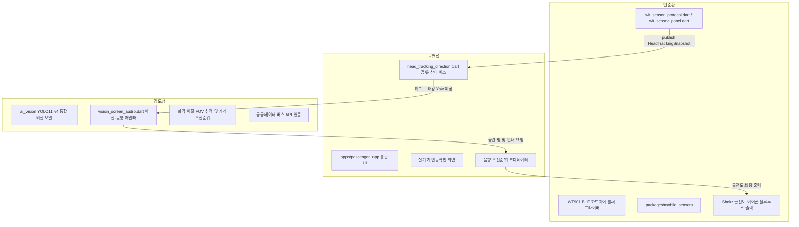
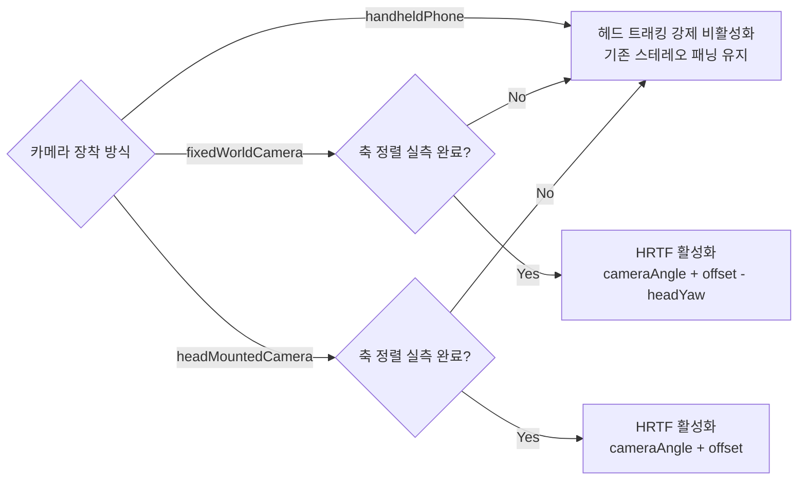

# WT901 IMU 센서 연동 아키텍처 및 시스템 가이드

> **문서 상태**: 공식 아키텍처 가이드  
> **관련 모듈**: `packages/mobile_sensors`, `apps/passenger_app/lib/src/features/hardware_bus`, `apps/passenger_app/lib/src/services`  
> **기준 브랜치**: `feat/vision-distance-priority` (PR #74)

---

## 1. 개요 및 목적

본 문서는 시각장애인 대중교통 승차 보조 시스템(MOBI-Smart-Transport)에서 사용자의 머리 회전(Head-Tracking)을 감지하는 **WT901BLE68 IMU 센서**의 하드웨어 스펙, 저수준 BLE 통신 프로토콜, 상위 앱 및 AI 비전과의 연동 아키텍처, 그리고 안전 정책(핸드헬드 스마트폰 모드 제한)을 명확하게 정리한 기술 문서입니다.

---

## 2. 팀 내 모듈 소유권 및 업무 분장 (Module Ownership)

저장소 협업 가이드라인(`MODULE_OWNERSHIP.md`)에 따른 역할 분담은 다음과 같습니다:



- **안준환**: WT901 하드웨어 통신, BLE GATT 패킷 파싱, 저수준 센서 프로토콜 유지보수.
- **윤현섭**: 상위 사용자 경험(UX), 세션 관리, 전역 `HeadTrackingState` 이벤트 버스 관리.
- **김도성**: AI 카메라 비전 검출, 객체 상대 각도 추출, 화각 이탈 시 출입문 인계, 비전-음향 어댑터 구현.

> [!IMPORTANT]
> **협업 주의사항**: 김도성(비전 담당)은 안준환 님의 저수준 센서 코드(`wit_sensor_protocol.dart`, `wit_sensor_panel.dart`)를 직접 수정하지 않으며, 윤현섭 님이 정의한 `HeadTrackingState` 인터페이스를 통해서만 센서 각도를 안전하게 읽어옵니다.

---

## 3. WT901 하드웨어 및 BLE 프로토콜 상세

### 3.1 하드웨어 규격
- **모델명**: WITMOTION WT901BLE68 (BLE 5.0)
- **디바이스 고유 MAC**: `F1:35:40:62:CD:43` (현장 실기기 기준)
- **센서 종류**: 9축 관성측정장치 (가속도, 자이로, 지자기)

### 3.2 패킷 규격 및 각도 계산
- WT901은 BLE 5.0 통신으로 20바이트 고정 길이 데이터 패킷을 전송합니다.
- 패킷 헤더: `0x55 0x61` (Angle Flag)
- 각 축(Roll, Pitch, Yaw) 데이터는 **Signed 16-bit Little-Endian** 정수로 전송됩니다:

$$\text{Angle (degrees)} = \frac{\text{Raw Data}}{32768} \times 180^\circ$$

### 3.3 저수준 필터링 및 안정화
- **시간 기반 Yaw 필터**: 순간적인 진동 및 노이즈 억제를 위해 80ms 시간 윈도우 필터를 거칩니다.
- **기준각(Reference Yaw) 보정**: 사용자가 정면을 바라본 상태에서 '정면 기준 설정'을 수행하여 상대 회전각을 계산합니다.
- **경계 래핑(Wrapping)**: 각도 차이가 발생할 때 항상 $[-180^\circ, +180^\circ]$ 범위로 정규화합니다.

---

## 4. 헤드 트래킹 공유 상태 버스 구조

상위 앱 레이어(`head_tracking_direction.dart`)에서는 센서와의 결합도를 낮추기 위해 **읽기 전용 이벤트 버스(`HeadTrackingState`)**를 운영합니다.

### 4.1 상태 라이프사이클 (`HeadTrackingStatus`)
1. `disconnected`: 센서가 연결되지 않음.
2. `connecting`: BLE 연결 시도 중.
3. `connectedUncalibrated`: 연결되었으나 정면 기준각 보정이 미완료됨.
4. `ready`: 정상 동작 중 (최신 Yaw 수신 및 보정 완료).
5. `stale`: 센서 데이터 수신 후 2초 이상 경과 (신선도 만료).
6. `error`: BLE 통신 오류 또는 센서 이상.

### 4.2 스냅샷 데이터 (`HeadTrackingSnapshot`)
```dart
class HeadTrackingSnapshot {
  final HeadTrackingStatus status;
  final double? rawYaw;          // 원본 센서 각도
  final double? filteredYaw;     // 80ms 필터링된 각도
  final double? referenceYaw;    // 정면 기준 각도
  final DateTime? receivedAt;    // 수신 시각 (UTC)
  final String message;
  
  // 데이터가 2초 이내의 유효한 READY 상태인지 확인
  bool usable(DateTime now, {Duration maximumAge = const Duration(seconds: 2)});
}
```

---

## 5. 카메라 장착 방식 및 안전 제한 정책 (핸드헬드 제한)

시스템은 `HeadTrackingCameraMount` 열거형을 통해 카메라의 물리적 장착 위치를 엄격하게 검증합니다:



### 5.1 핸드헬드(손에 든 스마트폰) 배제 이유 (Crucial Safety Policy)
> [!CAUTION]
> **스마트폰을 손에 들고 사용하는 경우(`handheldPhone`), 헤드 트래킹은 엄격히 차단(Fail-Closed)됩니다.**
> 
> - **원인**: 스마트폰을 손에 들고 있으면 팔의 흔들림, 손목 스냅, 이동 시 반동 등으로 인해 카메라 렌즈의 방향이 사용자의 머리(시선)와 완전히 분리되어 움직입니다.
> - **위험성**: 머리는 정면을 보는데 손이 오른쪽으로 치우치면, 센서는 머리가 돈 것으로 오인하여 잘못된 가상의 각도로 3D 입체음향 핑을 쏩니다. 이는 시각장애인에게 **치명적인 방향 착각(위험 오인)**을 유발합니다.
> - **해결책**: 핸드헬드 모드에서는 헤드 트래킹을 차단하고, 화면상의 Bbox 위치(좌/중/우)만을 정직하게 알려주는 3방향 스테레오 패닝(`playCue`)으로 안전하게 폴백합니다.

### 5.2 지원 가능한 장착 방식
1. **`headMountedCamera` (스마트 안경 / 헤드밴드 장착 카메라)**:
   - 카메라가 머리에 단단히 고정되어 시선과 일체화됩니다.
   - 카메라 뷰 자체가 이미 머리 기준 좌표계이므로, 센서 Yaw를 중복 차감하지 않습니다:
     $$\text{Azimuth} = \text{cameraAngle} + \text{cameraAxisOffset}$$
2. **`fixedWorldCamera` (외부 고정 카메라 / 정류장 CCTV)**:
   - 카메라가 세계 공간에 고정되어 있습니다.
   - 고정 카메라에서 본 객체 각도에서 사용자의 머리 회전각을 감산하여 사용자 머리 상대 방향을 계산합니다:
     $$\text{Azimuth} = \text{cameraAngle} + \text{cameraAxisOffset} - (\text{filteredYaw} - \text{referenceYaw})$$

---

## 6. AI 비전(`VisionScreenAudio`)과의 상호작용

AI 비전 파이프라인에서 WT901은 다음과 같이 유기적으로 연동됩니다:

1. **Bbox 각도 변환**:
   카메라 영상에서 검출된 객체 바운딩 박스 중심 $x_{center}$와 카메라 수평 화각($FOV_h$)으로부터 광학 축 각도를 도출합니다:
   $$\text{cameraAngle} = (x_{center} - 0.5) \times FOV_h$$
2. **헤드 트래킹 보정 및 입체음향 출력**:
   - `canActivateHeadTracking` 조건(수평 화각 확인 + 실측 축 정렬 완료 + `ready` 센서)이 충족되면, `headTrackedAngleForMount`를 통해 계산된 각도로 **HRTF 3D 핑(`playHeadTrackedCue(azimuth)`)**을 재생합니다.
   - 조건이 맞지 않거나 센서가 연결되지 않은 경우, 즉시 기본 좌/중/우 스테레오 패닝 핑(`playCue(direction)`)으로 매끄럽게 전환됩니다.
3. **화각 이탈(FOV Exit) 시 음향 동작**:
   - 버스 문에 가까워져 화면 중심에서 커지다가 사라지면: *"출입문이 바로 앞에 있습니다. 흰지팡이로 계단을 확인해 주세요."* (정면 핑 + TTS)
   - 좌/우 모서리로 이탈하면: *"출입문이 마지막으로 [왼쪽/오른쪽]에서 확인되었습니다. 몸을 [왼쪽/오른쪽]으로 돌려주세요."* (좌/우 핑 + TTS)

---

## 7. 현재 상태 요약

| 구성 요소 | 현재 상태 | 비고 |
| :--- | :---: | :--- |
| **WT901 저수준 프로토콜** | ✅ 구현 완료 | `wit_sensor_protocol.dart` (안준환) |
| **헤드 트래킹 버스 인터페이스** | ✅ 구현 완료 | `head_tracking_direction.dart` (윤현섭) |
| **비전-헤드트래킹 브릿지** | ✅ 구현 완료 | `vision_screen_audio.dart` (김도성) |
| **화각 이탈(FOV Exit) 인계 안내** | ✅ 구현 완료 | PR #74 포함 (김도성) |
| **거리 기반 객체 우선순위** | ✅ 구현 완료 | PR #74 포함 (김도성) |
| **실기기 하드웨어 장착 검증** | ⚠️ `NOT_VERIFIED` | 실물 기기 현장 검증 대기 중 |

> 김도성 담당 모듈(`ai_vision`, `vision_screen_audio`)은 WT901과의 연동 규격을 100% 충족하며, 안준환 님의 실물 센서 수락 절차와 완전히 독립적이면서도 안전하게 상호 운용되도록 설계되었습니다.
